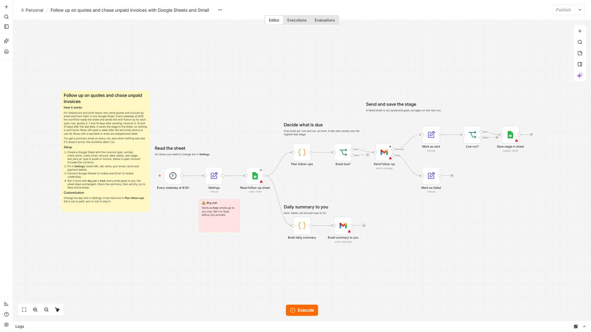

# Quote and Invoice Follow-up

> Published on [n8n Creator Hub](https://n8n.io/workflows/22462-send-quote-and-invoice-follow-up-emails-with-google-sheets-and-gmail/) · [TeloSignal](https://telosignal.com)

 

> Freelancers and small teams follow up on every open quote and unpaid invoice from one Google Sheet, without tracking reminder dates by hand.

## What this workflow does

Every weekday at 8:00 it reads a Google Sheet of quotes and invoices and sends the next due follow-up email through Gmail: quotes 3, 7 and 14 days after sending, invoices 3, 10 and 21 days after the due date. It writes the stage back to the sheet so no email goes out twice, and emails you a daily summary with a call list for rows that stay open after the last email.

## Workflow Overview

## Metric

Open rows that get their due follow-up on the day it is due — measured in the daily summary as sent vs. failed emails, plus rows skipped because of a bad date or email address.

## Pattern

Stateful reminder ladder: schedule → read sheet → compute days since date per row → pick the highest due stage → send via Gmail → write stage and date back → summarize.

## Principle

The sheet itself is the state. Each row stores its last stage, so a run only sends what is due and a late start sends one email (the highest due stage) instead of a backlog. A failed send is not saved and is retried on the next run. The summary arrives on every run, also when nothing was due, so a missing summary means the workflow did not run.

Trade-off: there is no Error Trigger. Send failures go to the error output of **Send follow-up** and into the summary; a crash before the summary step shows up as a missing summary email. Replies and bounces are not read.

## Question

Which other open item do you chase by date today — signed contracts, missing documents, renewals — and what would its day ladder be?

---

## Prerequisites

| Requirement | Detail |
|---|---|
| n8n version | tested on 2.43.7 self-hosted and n8n Cloud 2.46.4 |
| Credentials | Google Sheets OAuth2 (read and update), Gmail OAuth2 |
| n8n features | None — core nodes only |

## Setup

1. Import `workflow.json` into n8n.
2. Create a Google Sheet tab with these columns:

   | type | number | client_name | client_email | amount | date | status | last_stage | last_sent_at |
   |---|---|---|---|---|---|---|---|---|
   | invoice | INV-1042 | Example Ltd | billing@example.com | 1,250.00 EUR | 2026-11-01 | open | | |

   - `type` is `quote` or `invoice`, `status` is `open`.
   - `amount` includes the currency.
   - `date` is the quote's send date or the invoice's due date, as a date cell or `YYYY-MM-DD` text.
   - Leave `last_stage` and `last_sent_at` empty. Rows are matched by row number, no ID column needed.
3. Connect credentials: Google Sheets on **Read follow-up sheet** and **Save stage in sheet**, Gmail on **Send follow-up** and **Email summary to you**.
4. In **Settings**, set the sheet URL, tab name, your email, name, company and payment details. Adjust `quote_days` (default 3,7,14), `invoice_days` (default 3,10,21) and `call_after_days` (default 7) if needed.
5. Test: run once with `dry_run = true`. Every email goes to you and the sheet stays unchanged. Check the summary, then set `dry_run` to `false` and activate.

To stop follow-ups for a row, set its status to `paid`, `won` or `lost`. Email texts are in the **Plan follow-ups** node. The schedule uses your n8n instance time zone.

## Nodes used

| Node | Purpose |
|---|---|
| Schedule Trigger (Every weekday at 8:00) | Starts the run Monday to Friday at 8:00 |
| Set (Settings) | Holds sheet URL, tab, day ladders, sender details and `dry_run` |
| Google Sheets (Read follow-up sheet) | Reads all rows of the tab |
| Code (Plan follow-ups) | Validates each row, computes days since date and decides: email, call list or skip |
| IF (Email due?) | Routes rows with a due email to Gmail |
| Gmail (Send follow-up) | Sends the follow-up; failures go to its error output instead of stopping the run |
| Set (Mark as sent / Mark as failed) | Records the outcome per row |
| IF (Live run?) | Skips the sheet update in dry-run mode |
| Google Sheets (Save stage in sheet) | Writes `last_stage` and `last_sent_at` back to the row |
| Code (Build daily summary) | Collects sent, failed, call list and rows to fix |
| Gmail (Email summary to you) | Sends the summary on every run |

## Related

- [Google Sheets Batch Enrichment](../../data-enrichment/google-sheets-batch-enrichment/) — another sheet-driven workflow that writes results back row by row
- [n8n docs: Gmail node](https://docs.n8n.io/integrations/builtin/app-nodes/n8n-nodes-base.gmail/) — credentials and send options
